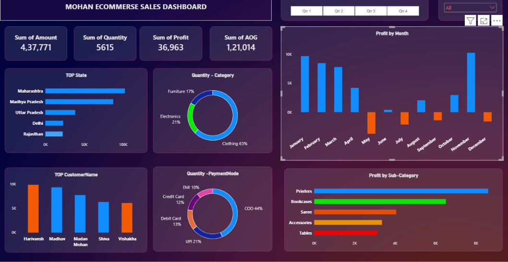

E-Commerce Sales Dashboard

Project Overview

An interactive E-Commerce Sales Dashboard created using Microsoft Power BI.

Tools Used

- Power BI
- Power Query
- DAX
- Microsoft Excel

Key Features

- Total Sales Analysis
- Profit Analysis
- Order Analysis
- Region-wise Sales
- Category-wise Sales
- Interactive Slicers and Filters

Skills

- Data Cleaning
- Data Transformation
- Data Analysis
- Data Visualization
- Dashboard Development

Project File

Power BI File: mohan ecommerce sales dashboard.pbix

Created By

Mohammad Ali

## Dashboard Preview

